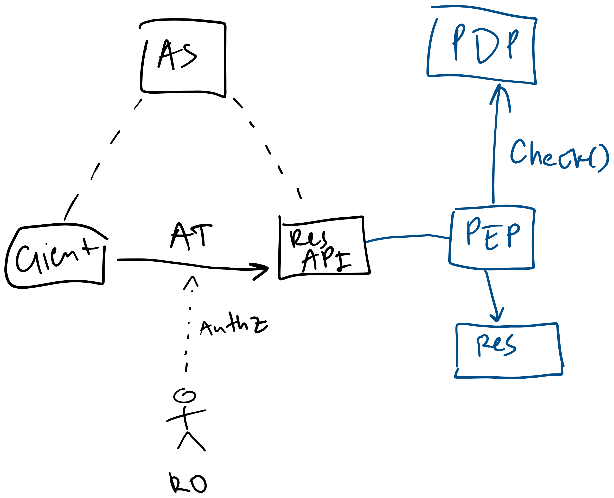
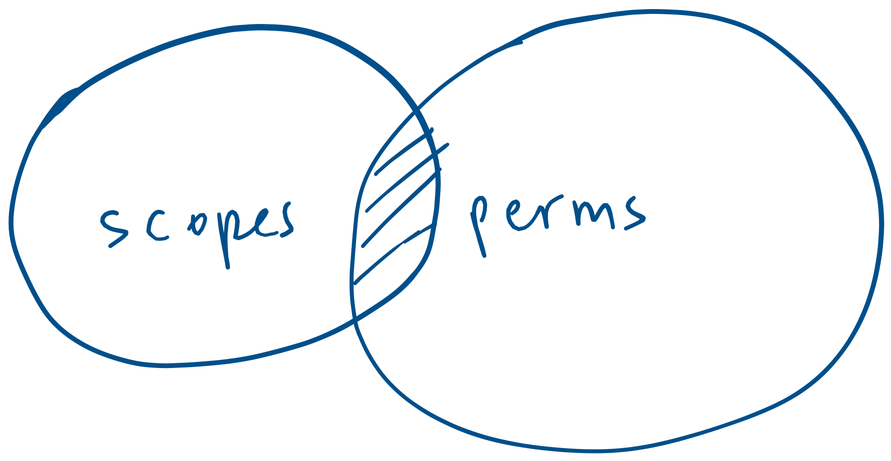
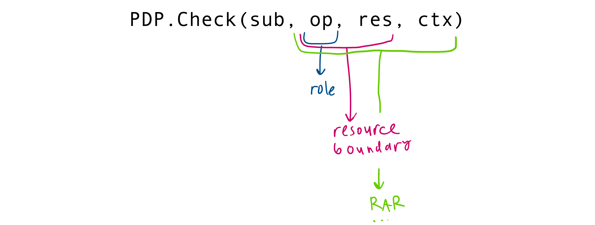
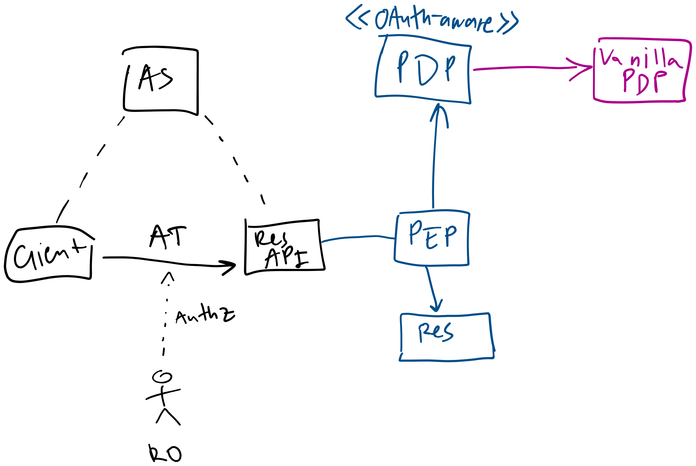
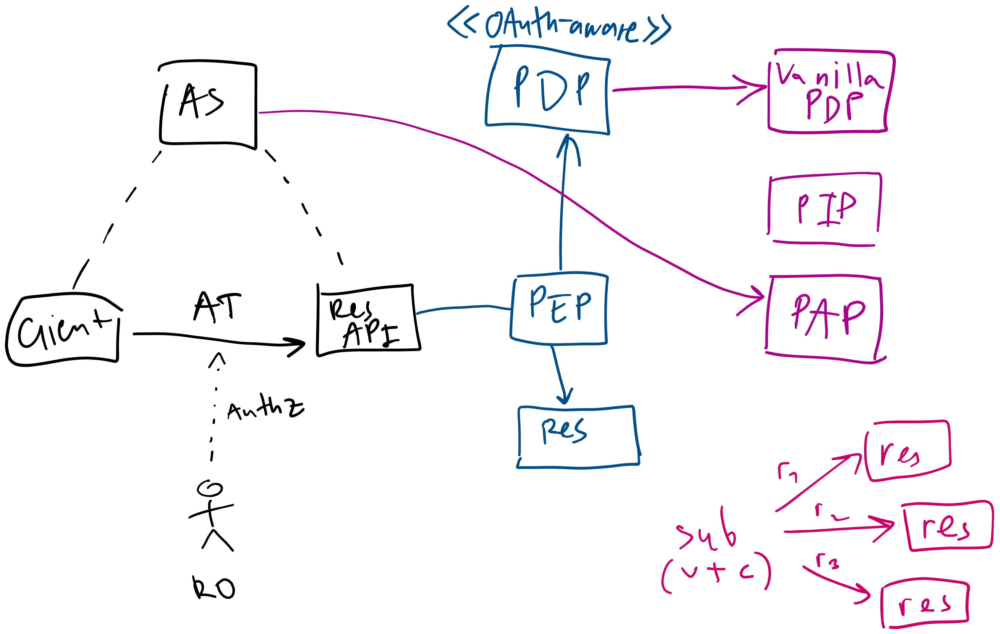
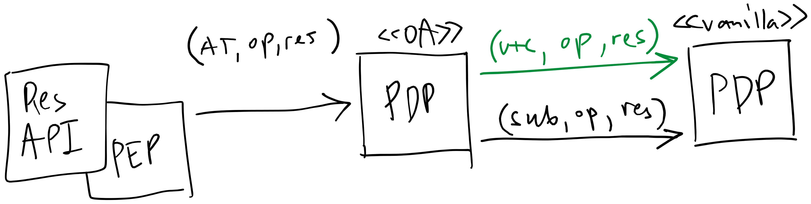
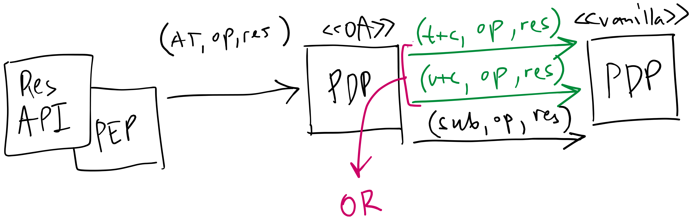
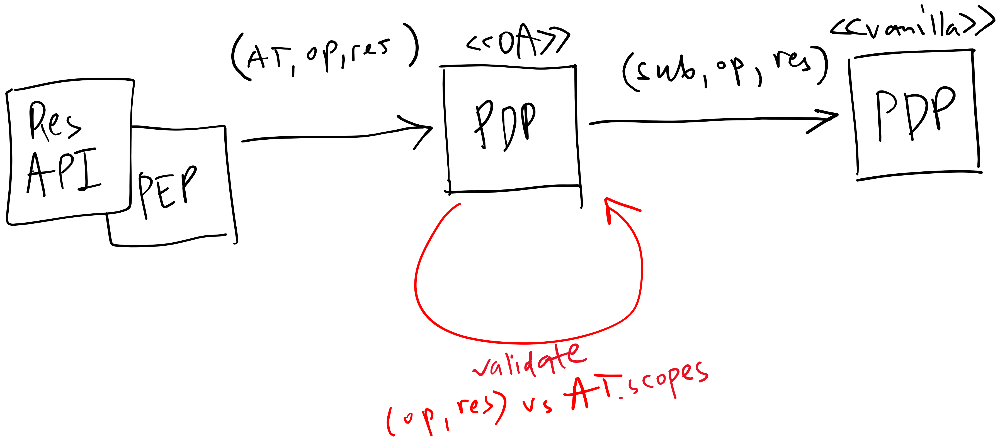

* TOC
{:toc}

## 1\. Introduction

OAuth 2.0 and traditional authorization models such as RBAC, ABAC, and ReBAC address different aspects of authorization:

- OAuth provides a framework for applications to obtain delegated access to protected resources. Access tokens carry information about the authority delegated to a client, but OAuth does not prescribe how resource API should use this information in the authorization mechanisms they have.
- On the other hand, authorization systems built around PEP/PDP architecture provide means to evaluate access to resources according to configured policies. However, they don't usually have built-in knowledge of OAuth concepts such as clients, scopes, and authorization grants.

In this article, I would like to explore how these two worlds can be connected without modifying the underlying PDP. In particular, it introduces means to

- Codify OAuth scopes in authorization policies and access tokens
- Express OAuth grants in traditional PEP/PDP architecture
- Authorize API requests using traditional PDP.

Basic considerations are:

- Developer should not change generic PDP code.
- The developer has a control over token generation and OAuth consent grant code.

&nbsp;

**Note:** This paper heavily is influenced by the fact that last several years I am working on cloud IAM. So, in many ways it may be biased to cloud authorization scenarios.

&nbsp;

## 2\. Codify OAuth scopes

On a picture below we've got a pieces of two worlds combined:

- \[black\] **OAuth framework:** AS/client/resource API triad, and a resource owner who authorizes client to get a scoped access token (AT).

- \[blue\] **PEP/PDP architecture:** a resource API authorizes each external request in PDP before letting it to reach a resource.

  

&nbsp;

It's safe to say that a resource API call should be authorized if both claims met:

1. OAuth client is authorized with a scope required to accomplish the request.
2. A subject on whose behalf a client is operating is authorized to accomplish the request.

In other words, a request can be found within an intersection between scopes authorized to a client and actual subject's permissions:



&nbsp;

So, what we can call a **scope**?  PEP usually calls something like *PDP.Check(subject, operation, resource, ctx)* so, it looks natural to form an individual scope as a combination of \{operation, resource, context\} where any element is optional.



Thus, if we take **operation** as a part of scope, a building part of a scope will be a named set of individual operations (**op-scope)**. In a "classic" cloud IAM this is also known as **role** (not to be confused with roles in RBAC).

**Example**: the *calendar.editor* op-scope could refer to a named set of individual operations like *\{ calendar.event:lists, calendar.event:get, calendar.event:create, … \}.*

When one choses to use both **operation,** and **resource** as a building part, a scope becomes a pair \{ op-scope, resource-filter \}; let's call it **res-scope**. Depending on business requirements, it might be useful to use res-scope instead of just op-scope, so client is limited within a *resource boundary* it cannot escape from.

**Examples**:

- a client can be authorized to read non-secret documents: *\{ document.reader, label:unclassified \}*
- a client can write objects under a specific object-hierarchy: *\{ storage.writer, "/foo/bar" \}.*

Choosing to extend res-scope with some context parameters makes scopes much more expressive but also system much complex in it's implementation. For example, a client can be authorized to transfer money to external accounts but only within specific budget limit.

**Note:** The OAuth Rich Authorization Requests (RAR) specification provides a structured way to express fine-grained authorization requirements. However, it does not prescribe how resource APIs should enforce them. The structured scopes described in this section are merely illustrative, intended to show how OAuth scopes can be expressed using authorization policies supported by a particular PDP.

&nbsp;

## 3\. Combined OAuth-PDP Architecture

In PEP/PDP architecture, each incoming API-request is intercepted by PEP, which communicates with PDP for authorization decision, e.g. PEP calls PDP.Check() method and either proceed request processing or returns authorization error.

The target architecture aims to express OAuth reality in a "vanilla" PDP without necessity to change it. To achieve this property, the system will have to implement "OAuth-aware" PDP that works as a smart proxy to "vanilla" PDP.

"OAuth-aware" PDP will:

- implement method *Check(access_token, operation, resource, context)*
- check validity of *access_token*
- interpret contents of *access_token* and convert it to a series of invocations of Check() method in "vanialla" PDP.



&nbsp;

## 4\. OAuth Use-cases Mapping to PEP/PDP

Lets discuss following OAuth use-cases in respect to authorization mechanics on PEP/PDP side:

1. \[UC.1\] Client makes an API request, with authorization grant persisted by a system.
2. \[UC.2\] Enterprise administrator pre-authorize some scopes for all users of his tenant.
3. \[UC.3\] Client makes an API request, when authorization grant codified in a token only.

### 4\.1 \[UC.1\] Persisted Authorization Grant

#### 4\.1.1 Persisting Grants

Generally typical OAuth flow can be depicted as series of steps, like:

- AS/oauth/authorize?client_id=\{cid\}?scopes… → (**user provides authorization grant**) → Client/callback?code → **access_token**

Depending on authorization flows, details may differ. The important parts here is user's consent approval and access_token generation.

To express persistent scopes, OAuth authorization endpoint will need to communicate with **PAP** endpoint to create policies that express OAuth scopes authorized by a specific grant:

- Create a new **synthetic subject** for the pair of \{ subject, client \} (u\+c subject on a picture below).
  The **u\+c** subject will not be able to authenticate, get access token, and will be hidden from end-users.
- Provide access policy that express granted scopes for the **u\+c** subject.
  For example, policy can be a set of access bindings in a form of triples (subject, role, resource).



**Implementation note:** Depending on the authorization model behind the PDP, a synthetic subject may either be explicitly created in the authorization system or exist only as part of an authorization relationship. An important property, though, is that it must have a deterministic ID that both the OAuth AS and the "OAuth-aware" PDP can generate from the same input parameters. For example, one could use `delegation:{client_id}:{subject_id}` as an ID generation scheme.

#### 4\.1.2 Token Contents

For this case, for authorization purposes an access token needs only *sub* and *client_id.* In this scenario, an access token does not carry scopes. We assume an implicit contract that the absence of *scopes* claim means that the token represents the default persistent authority granted to the client.

#### 4\.1.3 Authorization Flow

To authorize incoming API-request "OAuth-aware" PDP will have to

- Do all necessary validations for access token.
- Retrieve *sub* and *client_id* from access token and re-construct **u\+c** subject ID from (*sub*, *client_id*) pair.
- Perform a pair of authorizations in "vanilla" PDP:
  * Check(**u\+c**, operation, resource): *checking user authorized scopes corresponding to a current API-request.*
  * Check(sub, operation, resource): *actual end-user authorization.*



&nbsp;

### 4\.2 \[UC.2\] Persistent administrative grant

In this scenario, an administrator of a tenant grants client some default scopes for all users. For example, organization administrator grants CRM application to access calendar resource API for all users. So users of an organization need not grant those scopes for CRM client on login.

**Note:** This is illustrative example, as I believe that enterprise OAuth needs it's own in-depth best practices research.

For this design we assume that:

- Tenant administrator grants client scopes for all users of the tenant.
- If individual user authorizes client's scope, tenant-level and personal grants both work.
- Administrator can deny users to create individual grants.
  The denial would work as a part of grant authorization process, not API-request authorization flow.

#### 4\.2.1 Persisting Grants

The protocol for administrative grant can vary:

- it can be a part of Authorization Code Grant, where admin is explicitly asked if grants are tenant-wide or individual
- it could be a distinct flow for establishing trust between an OAuth client and a tenant/organization with it's own control plane.

In order to express approved tenant-level grants, OAuth AS will

- Create special subject for the pair \{ tenant, client\} (**t\+c** subject).
  The **t\+c** subject will not be able to authenticate, get access token, and will be hidden from end-users.
- Provide access policy that express granted scopes for the **t\+c** subject.
  For example, policy can be a set of access bindings in a form of triples (subject, role, resource), probably (subject, role, tenant).

#### 4\.2.2 Token Contents

Same as **UC.1**: *sub, client_id.*

Token may also contain explicit *tenant ID* unless a system can deduce it from subject ID.

For simplicity, we still consider that token does not contain any other scopes definitions.

#### 4\.2.3 Authorization Flow

The flow works in a similar way like in **UC.1** but taking into account more complex scenarios: client can have approved tenant-wide grants or individual per-user grants.

To authorize incoming API-request "OAuth-aware" PDP will have to

- Do all necessary validations for access token.

- Retrieve *sub* and *client_id* from access token and reconstruct **u\+c** subject ID from (*sub*, *client_id*) pair.

- Reconstruct **t\+c** subject ID from (t*enant_id, client_id*), where tenant_id is either obtained from the token or derived from the subject identity.

- Perform a pair of authorizations in "vanilla" PDP:

  - Check scopes grant authorization:
    - Check(**t\+c**, operation, resource)
    - OR
    - Check(**u\+c**, operation, resource)


  * Check(sub, operation, resource)

  

&nbsp;

### 4\.3 \[UC.3\] Authorization Using Token-contained Scopes

When a system opts to not persist authorization grant, approved scopes should be placed in a token.

#### 4\.3.1 Token Contents

For purposes of OAuth-aware authorization following claims become necessary: *sub, client_id, scopes.* The *scopes* claim can be in op-scope or res-scope form, depending on business requirements of a system.

For example, the JWT-alike token can look like:

```
{
	"sub": {subject_id},
	"client_id": {client_id},
	"scopes": [
		{
			"scope": {op-scope-name-1},
			"resource": {resource-filter-1}
		},
		...
	]
}
```

#### 4\.3.2 Authorization Flow

Some of modern PDPs allows PEP to provide temporary/ephemeral policies that are considered truthful inside a context of a request. **OpenFGA Contextual Tuples** is an example of feature.

So, if system is integrated with such "vanilla" PDP, "OAuth-aware" will:

- Do all necessary validations for access token.

- Construct a new synthetic subject that represents scopes from token specifically: **token-sub**.

  - We can codify token-sub as `delegation:token:{jti}` if we have *jti* claim or other thing serving token ID, like fingerprint.
  - The main point here is that token-derived synthetic subjects must never be targets of persisted authorization grants.

- Retrieve *scopes* from access token and transform the scopes into a **ephemeral policy** in terms of access grants made in favor of **token-sub**.

- Perform a pair of authorizations in "vanilla" PDP:

  * Check(**token-sub**, operation, resource, **ephemeral policy**): *checking token scopes are authorized for a current API-request.*
  * Check(sub, operation, resource): *actual end-user authorization.*


**Note 1:** We cannot use **u\+c** subject instead of **token-sub** in this case because in the u\+c case "vanilla" PDP would not be able tell persisted grants from ephemeral ones that came from token. Thus the token would potentially get more power than intended by it's creator.

**Note 2:** This method relies on an assumption that "vanilla" PDP implements the "ephemeral policy" feature in a way of building effective policy set as a union of persisted policies and ephemeral ones passed as a contextual parameter.

When "vanilla" PDP does not support ephemeral policies, "OAuth-aware" PDP will probably have to emulate it's behavior. This approach would make "OAuth-aware" PDP to incorporate knowledge about resource/policy structure and at least partially duplicate some logic "vanilla" PDP. So this is rather architectural trade-off.



### 4\.4 Put Puzzle Together

Finally, we can unify the approach from all three use-cases into one picture. Actually, there will be two pictures depending on fact if token contains specific scopes or not:


| **Token does not contain scopes**<br>Works according to 4.2.3 |  |
| **Token contains scopes**<br>Works according to 4.3.2 |  |


### 4\.5 More PDP Features in Charge

"OAuth-aware" PDP should always pass *client_id* from an authenticated token as a part of authoritative context attribute to "vanilla" PDP during **subject permissions validation**, e.g.:

```
	PDP.Check(sub, operation, resource, ctx.client_id = {token.client_id})
```

This may enable useful features on "vanilla" PDP side (if it has support):

- **Conditional bindings**: An administrator can grant some roles/permissions to end-users only if user access specific API via approved client.
- **DENY rules**: Deny some clients to access sensitive resources.

&nbsp;

## 5\. Further Development

This article does not cover client credentials, token exchange, multi-party authorization, and other useful delegation scenarios. I see good research perspectives in that respect.

The closest intuition I'd like to pay attention in near future is mixing restrictive and permissive structures in tokens. IMHO to be fully PDP-friendly OAuth tokens could be like:

```
{
	actor: {active-actor},
	scopes: [
		{
			scope: {permissions-scope},
			resource: {resource-filter}
		},
		...
	],
	delegations: [
		{
			delegator_subject: {sub-1}
			scope: {permission-scope},
			resource: {resource-filter}
		},
		...
	],
	...
}
```

With such design, one could construct tokens that are both scope/resource limited and also include active delegations from a number of subjects enabling transactions over complex resources administrated by different parties. And potentially allow resource usage scenarios that span more than one administrative/trust domains.

## 6\. Conclusion

In the article we propose an architecture pattern for OAuth-aware authorization in a traditional PEP/PDP framework. The pattern has several attractive properties:

* No changes to the underlying PDP implementation needed, provided its policy model supports the necessary authorization semantics.

* Delegated scopes are modeled as ordinary permissions that can be represented by policies supported by a specific PDP.

* Revocation can be accomplished by changing persisted policy rather than reissuing access tokens.

* The approach works with different underlying authorization models, taking into account that OAuth AS / "OAuth-aware" PDP can do a minimum work to translate the scopes into existing model.

